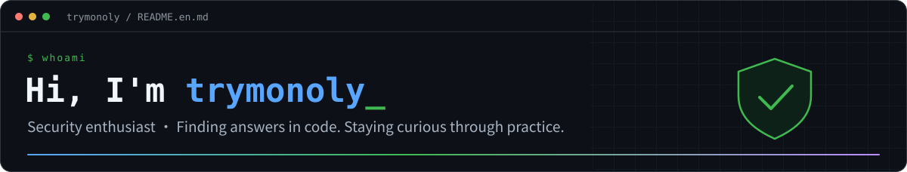

  
  

  

- 🛡️ A security enthusiast, always curious and eager to learn and share.
- 🔍 Focused on **code auditing and vulnerability research**, following the source to find answers.
- 🤖 Researching **AI Agents**, exploring agent collaboration and security automation.
- 🧬 Exploring **antivirus evasion and adversarial security research**, learning how detection and defense work.
- 🛠️ Passionate about **security tool development**, automating repetitive work and turning ideas into useful tools.
- 🤝 Happy to exchange ideas on code auditing, AI Agents, security research, and tool development. Let’s build together.

  📫 Find me: <a href="https://github.com/trymonoly">@trymonoly</a>

<h2 align="center">Hello, welcome to my GitHub 👋</h2>

  
  
  
  
  

  

  <picture>
    <source media="(prefers-color-scheme: dark)" srcset="./assets/snake-dark.svg" />
    <source media="(prefers-color-scheme: light)" srcset="./assets/snake.svg" />
    
  </picture>

  Stay curious · Keep exploring · Share what you learn

