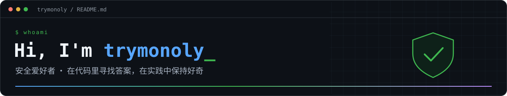

  
  

  

- 🛡️ 一名安全爱好者，保持好奇，持续学习与分享。
- 🔍 专注 **代码审计与漏洞研究**，喜欢从源码里追问题、找答案。
- 🤖 正在研究 **AI Agent**，探索智能体协作与安全自动化。
- 🧬 关注 **免杀研究与攻防对抗**，学习检测机制与防护原理。
- 🛠️ 热衷 **安全工具开发**，把重复的工作交给代码，把有趣的想法做成工具。
- 🤝 乐于交流代码审计、AI Agent、安全研究与工具开发，欢迎一起折腾。

  📫 找到我：<a href="https://github.com/trymonoly">@trymonoly</a>

<h2 align="center">你好，欢迎来到我的 GitHub 👋</h2>

  
  
  
  
  

  

  <picture>
    <source media="(prefers-color-scheme: dark)" srcset="./assets/snake-dark.svg" />
    <source media="(prefers-color-scheme: light)" srcset="./assets/snake.svg" />
    
  </picture>

  保持好奇 · 持续探索 · 乐于分享

